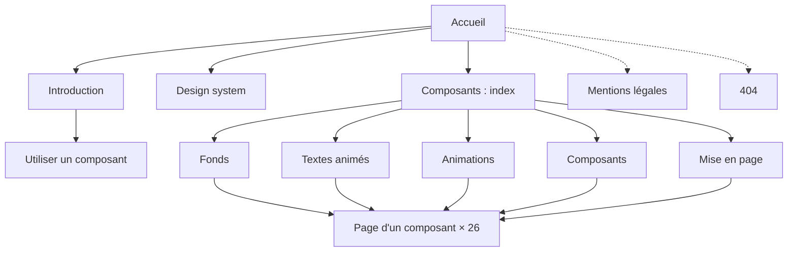
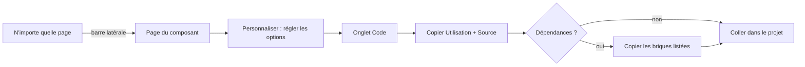

# 04 — Architecture de contenu & UX · KokoDesign

> Statut : brouillon, à valider · Date : 2026-11-24

S'appuie sur le PRD (MVP, 26 composants en cinq familles, ajout d'un composant en moins de 15 min), le territoire de marque (tutoiement, FR / EN, limites assumées) et la DA (structure de documentation façon vue-bits, couleur dans l'aperçu, planche `docs/06-maquettes/moodboard.html`).

---

## 1. Arborescence



| Page | Rôle | Dans la barre latérale |
|---|---|---|
| Accueil | Dire ce qu'est KokoDesign et envoyer vers les composants | Non (pas de barre latérale) |
| Introduction | Ce que contient le site, d'où viennent les briques, licence MIT | Démarrer |
| Utiliser un composant | Ce qu'il faut pour qu'un composant copié marche : `tokens.css`, polices, dépendances | Démarrer |
| Design system | Les tokens en vrai : couleurs et rôles, six fonds, typographie, espacements, motion | Démarrer |
| Composants (index) | Les 26 composants, rangés par famille, avec leur phrase d'usage | Non (c'est la barre latérale en grand) |
| Page d'un composant | Aperçu, Personnaliser, code, props, dépendances, limites | Oui, sous sa famille |
| Mentions légales | Obligation légale (éditeur, hébergeur) | Non, lien dans le pied de page |
| 404 | Ramener vers les composants | Non |

Les familles n'ont pas de page à elles : leur nom est un titre dans la barre latérale et une ancre de l'index (`/fr/composants#textes-animes`).

---

## 2. URLs

Même convention que le Portfolio : une langue par préfixe, `hreflang` sur chaque page, le sélecteur de langue mène à la page équivalente.

| Page | Français | Anglais |
|---|---|---|
| Accueil | `/fr` | `/en` |
| Introduction | `/fr/introduction` | `/en/introduction` |
| Utiliser un composant | `/fr/utiliser` | `/en/usage` |
| Design system | `/fr/design-system` | `/en/design-system` |
| Composants | `/fr/composants` | `/en/components` |
| Page d'un composant | `/fr/composants/letter-reveal` | `/en/components/letter-reveal` |
| Mentions légales | `/fr/mentions-legales` | `/en/legal-notice` |

- **La famille n'est pas dans l'URL** : un composant peut changer de famille sans casser ses liens. *(Proposition, voir § 9.)*
- **Le slug est le nom du composant en kebab-case**, identique dans les deux langues (c'est le nom qu'on tape dans le code). La directive `v-reveal` garde `v-reveal`.
- La racine `/` redirige vers `/fr` ou `/en` selon la langue du navigateur (détail en phase 7).

---

## 3. Navigation

| Élément | Contenu |
|---|---|
| **En-tête** | Logo (→ accueil) · Composants · Design system · sélecteur FR / EN · lien GitHub du dépôt |
| **Barre latérale** (toutes les pages sauf l'accueil, l'index et la 404) | Démarrer : Introduction, Utiliser un composant, Design system. Puis les cinq familles et leurs composants, dans l'ordre du PRD. Page en cours en lime |
| **Bas de page d'un composant** | Composant précédent / suivant (`NextLink`, la brique du design system) |
| **Pied de page** | « Fait par l'auteur de costamask.dev » (lien vers le Portfolio) · GitHub · Licence MIT · Mentions légales |
| **Mobile** (< 1024 px) | Un bouton « Composants » dans l'en-tête ouvre la barre latérale par-dessus la page ; elle se ferme au choix d'un lien ou avec Échap |

---

## 4. Contenu par page

### Accueil

| # | Section | Message clé | Action |
|---|---|---|---|
| 1 | En-tête de page (fond violet + `TopoBackground`) | « KokoDesign » en `LetterReveal`, la promesse | **Parcourir les composants** (→ index) · Voir le design system |
| 2 | Trois aperçus vivants | Un composant par famille visuelle (un fond, un texte animé, une animation), chacun avec son lien | Ouvrir le composant |
| 3 | « D'où viennent ces briques » | Elles font tourner costamask.dev ; tokens, accessibilité et animations réduites inclus | Lien vers le Portfolio |

### Composants (index)

Titre, une phrase (« 26 briques Vue, prêtes à copier. »), puis une section par famille : nom de la famille, une ligne qui la décrit, la liste de ses composants (nom + phrase d'usage). Pas de vignettes animées : 26 démos en même temps alourdiraient la page.

### Page d'un composant

Ordre fixe, le même pour les 26 (valeur « Rigoureux ») :

| # | Bloc | Contenu |
|---|---|---|
| 1 | Titre | Nom du composant (Bagel) + phrase d'usage (< 15 mots) |
| 2 | Onglets **Aperçu / Code** | — |
| 2a | Aperçu | Barre : six fonds, Rejouer. Scène : la démo sur le fond choisi (fond par défaut propre à chaque composant) |
| 2b | Code | **Utilisation** : l'appel du composant avec les réglages en cours, copiable. **Source** : le fichier `.vue` complet, copiable *(proposition, voir § 9)* |
| 3 | Personnaliser | Un contrôle par option réglable (texte, nombre, booléen, liste) + l'interrupteur « Animations réduites » |
| 4 | Props | Tableau : nom, type, défaut, rôle. Puis slots et événements s'il y en a |
| 5 | Dépendances | Ce que le composant demande en plus de `tokens.css` : autre brique (`BaseIcon`), bibliothèque (GSAP), police |
| 6 | Accessibilité et limites | Encadré rose : comportement en animations réduites, clavier et lecteur d'écran, quand **ne pas** l'utiliser |
| 7 | Précédent / suivant | `NextLink` |

### Utiliser un composant

1. Copier `tokens.css` (lien pour le télécharger ou le copier) et l'importer une fois.
2. Copier les polices si tu veux le rendu exact (liens, licences OFL).
3. Copier le composant (onglet Code, « Source »), puis ses dépendances listées sur sa page.
4. Exemple complet de bout en bout, avec un composant simple (`BaseButton`).

### Design system

Les tokens affichés en vrai, avec un bouton pour copier chaque nom de variable : couleurs de base et rôles (avec contrastes), six fonds de section, typographie (échelle en direct), espacements et rayons, motion (durées et courbe, chacune avec une petite démo rejouable). Reprend la vitrine du design system du Portfolio.

### Introduction

Ce qu'est KokoDesign (la promesse), d'où viennent les briques, ce qu'on y trouve (cinq familles), licence MIT, ce que le site n'est pas (pas de paquet npm, pas de support).

### 404

« Cette page n'existe pas. » + lien vers l'index des composants. *(La brique manquante du Portfolio reste au Portfolio.)*

---

## 5. Parcours

### Toi, développeur — récupérer un composant (action principale)



Cible : **moins de 30 s** du site au code collé (territoire de marque § 9). Deux clics après la page du composant : onglet Code, Copier.

### Le visiteur — juger la qualité en moins de 2 minutes

Lien (CV, réseau) → **Accueil** (nom animé, promesse) → un des trois aperçus → **page du composant** : change le fond, joue avec Personnaliser → barre latérale, un autre composant → pied de page, lien vers le Portfolio.

### Le dev de passage — arrivé par un moteur de recherche

Recherche (« vue letter reveal animation ») → **page du composant** directement → Code → Copier → s'il manque quelque chose : bloc **Dépendances** → **Utiliser un composant** (pour `tokens.css`).

Conséquence : chaque page de composant doit se suffire à elle-même (dépendances listées, lien vers « Utiliser un composant »).

### Toi, mainteneur — ajouter un composant (< 15 min)

1. Créer le dossier du composant dans sa famille : le fichier `.vue` et sa fiche de documentation (phrase d'usage FR / EN, props, contrôles, dépendances, limites).
2. Rien d'autre : la barre latérale, l'index, les routes FR / EN, le précédent / suivant et le sitemap se mettent à jour seuls.

Le format exact de la fiche est fixé en phase 5 (design system) et en phase 7 (architecture technique). Point de départ : `catalogue.ts` du Portfolio.

---

## 6. États

| Où | État | Ce que voit l'utilisateur |
|---|---|---|
| Aperçu | Chargement (fond WebGL) | La scène affiche déjà le fond de couleur ; la démo apparaît par un fondu |
| Aperçu | WebGL indisponible | Image fixe du fond + « Ton navigateur ne gère pas WebGL : voici une image fixe du rendu. » |
| Aperçu | Animations réduites demandées par le système | L'interrupteur est coché au chargement, avec la mention « Ton système demande des animations réduites. » ; tu peux le décocher pour voir l'animation complète |
| Aperçu | Hors de l'écran | Démo en pause (aucun message) |
| Personnaliser | Valeur hors limites (champ texte) | Longueur limitée par le champ ; les nombres sont des curseurs bornés, donc pas d'erreur possible |
| Copier | Réussite | « Copié » pendant 2 s |
| Copier | Échec (presse-papiers refusé) | « Copie impossible : sélectionne le code et copie-le à la main. » |
| Page | Composant ou page inconnue | 404 |
| Page | JavaScript désactivé | Pages statiques lisibles (titre, phrase, props, code source) ; aperçu et Personnaliser indisponibles, avec une phrase qui le dit |

---

## 7. Wireframes

Basse fidélité, sans décision visuelle. La planche de la phase 3 montre déjà l'accueil et une page de composant en haute fidélité.

**Page d'un composant (desktop)**

```
┌──────────────────────────────────────────────────────────────────┐
│ Logo        Composants   Design system   FR/EN   GitHub          │
├──────────────┬───────────────────────────────────────────────────┤
│ Démarrer     │ Nom du composant                                  │
│  Introduction│ Phrase d'usage                                    │
│  Utiliser    │ [Aperçu][Code]                                    │
│  Design sys. │ ┌───────────────────────────────────────────────┐ │
│ Fonds        │ │ ○○○○○○ fonds                         Rejouer │ │
│  …           │ │                                               │ │
│ Textes animés│ │                 démo                          │ │
│ ▌LetterReveal│ │                                               │ │
│ Animations   │ └───────────────────────────────────────────────┘ │
│  …           │ Personnaliser   [contrôle][contrôle][contrôle]    │
│ Composants   │ Props           tableau                           │
│  …           │ Dépendances     liste                             │
│ Mise en page │ ┃ Accessibilité et limites                        │
│  …           │ ← Précédent                         Suivant →     │
├──────────────┴───────────────────────────────────────────────────┤
│ Portfolio · GitHub · MIT · Mentions légales                      │
└──────────────────────────────────────────────────────────────────┘
```

**Index des composants**

```
┌──────────────────────────────────────────────────────────────────┐
│ En-tête                                                          │
├──────────────────────────────────────────────────────────────────┤
│ Composants                                                       │
│ 26 briques Vue, prêtes à copier.                                 │
│                                                                  │
│ Fonds — une ligne de description                                 │
│   TopoBackground    phrase d'usage                               │
│   SectionWave       phrase d'usage                               │
│ Textes animés — …                                                │
│   LetterReveal      phrase d'usage                               │
│ …                                                                │
└──────────────────────────────────────────────────────────────────┘
```

**Mobile** : même ordre en une colonne ; la barre latérale passe derrière le bouton « Composants » de l'en-tête ; les contrôles de Personnaliser s'empilent ; le tableau des props défile horizontalement.

---

## 8. SEO

| Page | `<title>` | Description |
|---|---|---|
| Accueil | KokoDesign, composants Vue prêts à copier | La promesse |
| Composant | `LetterReveal`, composant Vue (texte animé) — KokoDesign | Sa phrase d'usage |
| Index | Tous les composants Vue — KokoDesign | « 26 briques Vue… » |

- Intentions visées : « vue [effet] component », « composant vue [effet] », par composant (ex. « vue text reveal animation », « vue topographic background webgl »).
- Pages générées en HTML statique (contenu lisible sans JavaScript), `sitemap.xml` avec les deux langues, `hreflang`, Open Graph (image par défaut : logo sur fond violet).
- Pas d'analytics au MVP (PRD).

---

## 9. Questions ouvertes

1. **URL sans la famille** (`/fr/composants/letter-reveal`, recommandé, liens stables) ou avec (`/fr/textes-animes/letter-reveal`, comme vue-bits) ?
2. **Onglet Code** : Utilisation **et** source complète (recommandé : c'est ce qui rend le copier-coller autonome), ou seulement la source ?
3. **Mentions légales** : une page à KokoDesign (recommandé, même hébergeur à nommer), ou un lien vers celles du Portfolio ?
